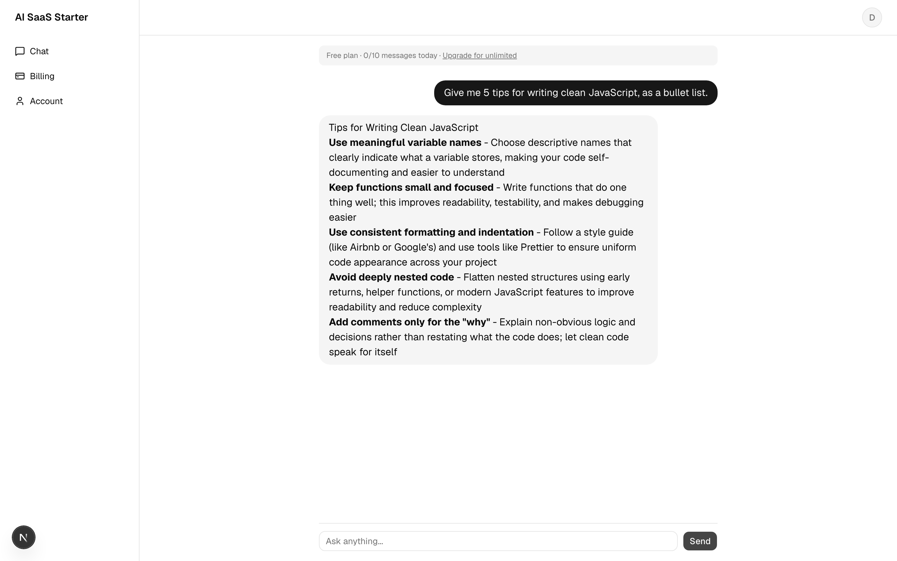

# 🚀 Next.js AI SaaS Starter Kit

**Launch your AI SaaS this weekend.** A production-ready Next.js starter with
authentication, Stripe subscriptions, **usage limits**, and a streaming AI chat
already wired together, so you skip weeks of boilerplate and ship your product.

**Free & open-source (MIT).** If it saves you time, a ⭐ means a lot.

> 📬 **Building this in public** — [get the next drop + Pro early access →](https://surfings-newsletter.beehiiv.com/subscribe)



---

## ✨ Features

- ⚡ **Next.js 16** (App Router) + TypeScript + Tailwind CSS v4 + **shadcn/ui**
- 🔐 **Better Auth** — email/password, secure sessions, protected routes via middleware
- 💳 **Stripe** — subscription checkout, **billing portal** (manage/cancel), webhooks that sync plan state
- 🤖 **Streaming AI chat** (Vercel AI SDK) — swap any model (Anthropic/OpenAI/Ollama)
- 💬 **Saved chat history** + **Markdown rendering** (headings, lists, code blocks) + auto-scroll
- 🚦 **Usage limits** — free-plan daily message cap, Pro = unlimited (keeps your AI bill sane)
- 🧭 **Dashboard shell** — sidebar layout (Chat · Billing · Account), session-aware landing page
- 🌗 **Dark mode** (next-themes), **toast notifications** (sonner)
- 🗄️ **Drizzle ORM** + Postgres — typed schema, one-command migrations
- ✅ **Env validation** (zod) — clear errors instead of cryptic crashes

## 🧰 Tech stack

| Layer | Tech |
|-------|------|
| Framework | Next.js 16, React 19 |
| Styling | Tailwind v4, shadcn/ui |
| Auth | Better Auth |
| Payments | Stripe |
| AI | Vercel AI SDK |
| DB | Drizzle ORM + Postgres |

---

## ⚡ Quick start (5 minutes)

```bash
pnpm install
cp .env.example .env            # fill in the values (see below)
openssl rand -base64 32         # -> BETTER_AUTH_SECRET

pnpm approve-builds             # allow esbuild + pg native builds
pnpm auth:generate              # generate Better Auth schema from your config
pnpm db:push                    # create tables in your Postgres
pnpm dev                        # http://localhost:3000
```

### Environment variables
| Var | What |
|-----|------|
| `DATABASE_URL` | Postgres connection string (local, or Neon/Supabase free tier) |
| `BETTER_AUTH_SECRET` | `openssl rand -base64 32` |
| `BETTER_AUTH_URL` | your app URL (e.g. `http://localhost:3000`) |
| `NEXT_PUBLIC_APP_URL` | your app URL |
| `ANTHROPIC_API_KEY` | for the AI chat (or set `OPENAI_API_KEY` and swap the model) |
| `STRIPE_SECRET_KEY` | Stripe secret key (optional until you want payments) |
| `STRIPE_WEBHOOK_SECRET` | from `stripe listen` or dashboard |
| `STRIPE_PRO_PRICE_ID` | price ID of your Pro subscription |

> Payments are optional for local dev — leave the Stripe vars as placeholders and
> everything except the upgrade flow works.

### Stripe webhooks (local)
```bash
stripe listen --forward-to localhost:3000/api/stripe/webhook
```

---

## 🗺️ Project structure

```
src/
  app/
    (auth)/sign-in, sign-up        # auth pages
    (app)/                          # protected dashboard shell (sidebar layout)
      chat/                         # streaming chat (saved history + markdown)
      billing/                      # plan + upgrade / manage subscription
      account/                      # profile + plan
    pricing/                        # Free vs Pro
    api/auth/[...all]/              # Better Auth handler
    api/chat/                       # AI streaming + usage-limit enforcement
    api/stripe/checkout|portal|webhook/
    page.tsx                        # session-aware landing page
  db/                               # Drizzle client + schema (auth + chat)
  lib/
    auth.ts, auth-client.ts         # Better Auth server + client
    stripe.ts, plans.ts, env.ts     # Stripe, plan limits, env validation
  middleware.ts                     # route protection
  components/                       # UI (chat, user-menu, markdown, shadcn/ui)
```

## 🔧 Customize

- **Swap AI model:** `src/app/api/chat/route.ts` (default `anthropic("claude-haiku-4-5")`).
- **Tune usage limits:** `src/lib/plans.ts` (`FREE_DAILY_MESSAGE_LIMIT`).
- **Add auth providers / social login:** extend `src/lib/auth.ts`, then `pnpm auth:generate && pnpm db:push`.
- **Change plans/pricing:** `src/app/pricing/page.tsx` + your Stripe product.
- **Brand it:** `src/app/page.tsx` + `src/app/layout.tsx` metadata.

## 📦 Deploy
Deploy to Vercel. Set the env vars, point the Stripe webhook at
`https://yourdomain/api/stripe/webhook`, and ship.

---

## 📄 License
**MIT** — free for personal and commercial projects. Build whatever you want with it.

## 💛 Support
This is free and open-source. If it helped you ship faster:
- Drop a ⭐ on the repo (it genuinely helps others find it)
- A "Pro" version with teams, social login, and more is in the works — [follow along](https://x.com/coder_surfer)

Built by [SurfingCoder](https://x.com/coder_surfer).
